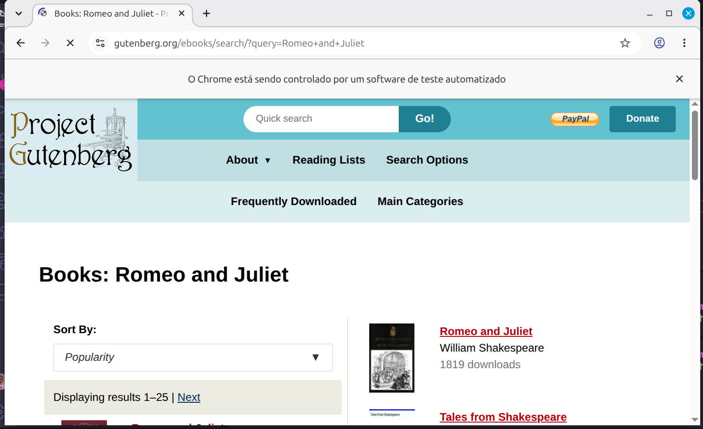
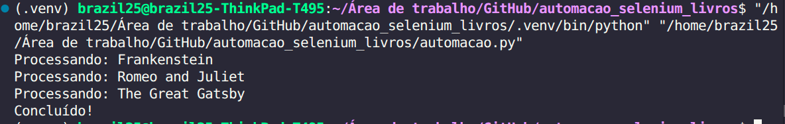

# Automação com Selenium - Busca de Livros

Busca de livros automatizada na plataforma Project Gutenberg, de livros gratuitos.

---

## Demonstração

| Busca de Livros | Prints das Buscas  |
| :---: | :---: |
|  |  |

---

## Tecnologias

Este projeto foi desenvolvido utilizando as seguintes tecnologias:

- **Python 3.12.3**
- **Selenium (Raspagem de dados da internet)**
- **Pandas (Manipulação e leitura de planilhas)**

---

## Funcionalidades

- [x] Leitura de bancos de dados em Excel
- [x] Raspagem de dados do site Project Gutenberg
- [x] Criação de arquivo atualizado em Excel

---

## Estrutura de Dados

O projeto conta com um arquivo `Produtos.xlsx` contendo exemplos de livros para permitir o teste da raspagem de dados. O arquivo atualizado gerado é salvo automaticamente na pasta raiz do projeto.

---

## Como Executar o Projeto

### Pré-requisitos

Antes de começar, você precisará ter instalado em sua máquina:
- [Git](https://git-scm.com)
- [Python 3.12](https://www.python.org/)

### Passo a Passo

1. **Clone este repositório:**
   ```bash
   git clone https://github.com/Brazil25/automacao_selenium_livros/
   ```

2. **Acesse a pasta do projeto:**
   ```bash
   cd automacao_selenium_livros
   ```

3. **Crie e ative o ambiente virtual (opcional, mas recomendado):**
   ```bash
   python -m venv .venv
   source venv/bin/activate  # Linux/Mac
   # ou: venv\Scripts\activate  # Windows
   ```

4. **Instale as dependências:**
   ```bash
   pip install -r requirements.txt
   ```


5. **Execute a aplicação:**
   ```bash
   python automacao.py
   ```

---

## Licença

Este projeto está sob a licença MIT.
>>>>>>> fda563c (Atualização do arquivo README.md)
